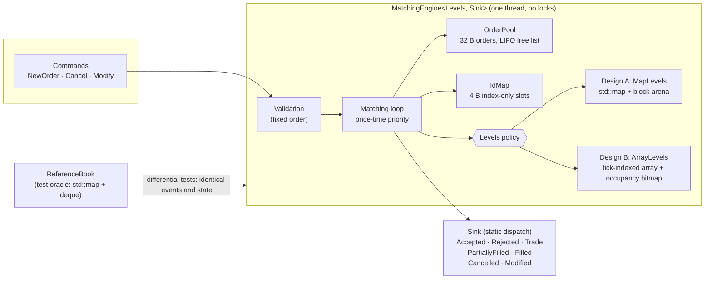

# lob-engine

A single-instrument limit order book and matching engine in C++20. It has
price-time priority, integer prices and quantities, and no heap allocation
after construction. Two price-level designs are benchmarked against each
other, and both are checked against a deliberately naive reference book on
hundreds of millions of random commands.

| | |
|---|---|
| **Throughput** | **13.3 ns per command (75 M commands/s)**: design B on a realistic add/cancel-heavy book, Apple M4 Max |
| **Per-operation latency** | design B mean 24.9 ns, p99 42 ns, p99.9 84 ns (including ~13 ns timer overhead; macOS clock step 42 ns) |
| **Correctness** | 300M random commands per campaign matched the reference book, event for event and state for state, on every engine |
| **Allocation** | zero heap allocations from the first command after construction (counted, not assumed) |
| **CI** | GCC 14, Clang 18 and Apple Clang; release and ASan+UBSan; clang-tidy and clang-format; benchmark smoke runs |

Every number in this README comes from a recorded run with its hardware,
flags and workload stated. Raw data is in [docs/results/](docs/results/), and
the full log is in [docs/benchmarks.md](docs/benchmarks.md). The numbers come
from a desktop Mac, not a tuned Linux box; see
[Benchmark methodology](#benchmark-methodology) for what that does and
doesn't allow you to conclude.

Design decisions, with the alternatives considered, are in
[docs/design.md](docs/design.md). This README is the summary.

---

## Contents

1. [Architecture](#architecture)
2. [Matching semantics](#matching-semantics)
3. [Data structures and memory layout](#data-structures-and-memory-layout)
4. [Design decisions and rejected alternatives](#design-decisions-and-rejected-alternatives)
5. [Why the matching core is single-threaded](#why-the-matching-core-is-single-threaded)
6. [Correctness](#correctness)
7. [Benchmark methodology](#benchmark-methodology)
8. [Results](#results)
9. [Profiling: what made it fast](#profiling-what-made-it-fast)
10. [Known limitations](#known-limitations)
11. [Next steps](#next-steps)
12. [Building and running](#building-and-running)

---

## Architecture



- **One matching implementation, parameterized** on the price-level
  container and the event sink, both as template parameters. Every call is
  static and inlinable; there are no virtual functions on the hot path.
  Design A and design B share all validation, matching and modify logic, so
  benchmarking them measures only the data structure.
- **The reference book** (`reference/`) is a separate, deliberately simple
  implementation built from `std::map<Price, std::deque<OrderId>>` and an
  `unordered_map`. It shares nothing with the engine except the input,
  event and snapshot types, so a bug in one can't hide in the other.
- **Modules:**

  | Directory | Contents |
  |---|---|
  | `include/lob/` | API types, commands, events, sinks, `OrderBook` concept |
  | `include/lob/engine/` | the engine and its containers |
  | `reference/` | test oracle |
  | `workload/` | deterministic generator, workload replay, differential driver, latency histogram |
  | `tests/` | unit, differential and allocation tests |
  | `bench/` | Google Benchmark suites and the per-op latency harness |
  | `tools/` | `lob_fuzz` |

## Matching semantics

| Case | Behaviour |
|---|---|
| Limit order that crosses | Fills against the opposite side at the **resting** price, best price first and FIFO within a level; any remainder rests (GTC) |
| Market order | Sweeps until filled or the opposite side is empty; any remainder is cancelled with `NoLiquidity` (IOC) |
| Cancel | Removes the order; reports its open quantity |
| Modify, same price, total not increased | Amended in place; **keeps** queue priority |
| Modify, price change or total increased | Cancel/replace; **loses** priority. If the new price crosses, it matches immediately |
| Modify to total <= filled | Order cancelled (`ReducedToFilled`) |
| Invalid input | Rejected with a reason: `InvalidQuantity`, `PriceOutOfBand`, `DuplicateOrderId`, `UnknownOrderId`, `CapacityExceeded` |

- **`Modify.qty` is the new total order quantity**, including what has
  already filled (FIX `OrderQty` semantics). It stays safe if a fill races
  the modify: asking for "10 → 8" can never leave more than 8 lots of total
  exposure.
- **Events follow a fixed order:**
  - a new order produces `Accepted` or `Rejected`;
  - then, per match: `Trade`, the resting order's status, the incoming
    order's status;
  - a market order's unfilled remainder ends with `Cancelled(NoLiquidity)`.

  The order is part of the contract, since differential testing compares
  event streams exactly.
- **Prices are `int64` ticks and quantities are integers.** No floating point
  anywhere in the matching path; `-Wfloat-equal` is an error.

## Data structures and memory layout

All layouts are enforced with `static_assert`.

**`Order`: 32 bytes, 32-byte aligned** (two per 64 B cache line; never
straddles one)

```
offset size field
     0    8 id      client order id; also the id map's key
     8    4 leaves  open quantity
    12    4 total   total order qty incl. filled (filled = total - leaves)
    16    4 prev    \  intrusive doubly-linked FIFO within the level,
    20    4 next    /  as 32-bit pool indices (next doubles as free-list link)
    24    4 level   handle of the level it rests on -> O(1) cancel, price via level
    28    1 side
```

**`Level`: 32 bytes.** Fields: price (8), total open quantity (8, 64-bit),
head (4), tail (4), count (4), side (1).

**Containers:**

| Structure | What it is | Hot-path cost |
|---|---|---|
| `OrderPool` | Fixed slab of `Order`, intrusive LIFO free list, allocated and touched at construction. Only orders that rest take a slot; an incoming order is matched as a stack-local struct | O(1) allocate/release |
| `IdMap` | Linear probing over **4-byte index-only slots**; keys are read back from the pool. Fibonacci hashing, load <= 0.5, backward-shift deletion (no tombstones) | O(1) expected |
| Design A: `MapLevels` | `std::map<Price, LevelRef>` per side (`greater<>` for bids, `less<>` for asks, so `begin()` is best), nodes from a pre-sized `BlockArena`; `Level`s in a contiguous pool | best O(1), level create/erase O(log L) |
| Design B: `ArrayLevels` | One `Level` per tick of the price band, shared by both sides (the book is never crossed between commands). Per-side two-level occupancy bitmap for next-best search | everything O(1); next-best search ~O(1) |

## Design decisions and rejected alternatives

| Decision | Chosen | Rejected, and why |
|---|---|---|
| Polymorphism over level designs | Template parameter (`PriceLevels` concept) | Virtual interface: an indirect call per operation and no inlining. Two separate engines: they'd compare implementations rather than data structures |
| Order links | 32-bit pool indices | Raw pointers: twice the size, and they rule out one contiguous slab |
| Order id lookup | Custom open-addressing map, index-only slots | `std::unordered_map`: a node allocation per insert plus pointer chasing. `absl::flat_hash_map`: adds a dependency, stores full keys |
| Hash-map deletion | Backward shift | Tombstones: probe lengths decay under add/cancel churn and force rehashes |
| Tree nodes (design A) | Hand-written fixed-block arena allocator | `std::pmr::unsynchronized_pool_resource`: can fall through to its upstream allocator, and adds a virtual call per allocation |
| Next-best level (design B) | Two-level occupancy bitmap | Linear scan: as fast on typical books, but O(gap). It measured about 1 µs to cross 4,096 empty ticks, exactly when the top of the book has just been swept |
| Price band (design B) | Bounded band (<= 4M ticks), checked at construction | A recentring circular window: wrap-around arithmetic on every index. A hash map from price to level: loses the locality that is design B's point |
| Event delivery | Statically dispatched sink; events have no sequence number | A virtual listener interface. Sequence numbers belong to the publisher that serialises the stream |
| Market orders | A limit order at `INT64_MAX` / `INT64_MIN` | A separate code path: an extra branch in the matching loop |
| Price, quantity and id types | `StrongInt<Rep, Tag>` wrappers (zero cost) | Plain `int64_t` aliases: swapped arguments compile silently |
| Random workloads | Hand-written xoshiro256** and integer distributions | `<random>` distributions: they produce different sequences under libc++ and libstdc++, so a failing seed wouldn't reproduce across platforms |

## Why the matching core is single-threaded

- **Matching is inherently sequential.** Every command's outcome depends on
  the book state the previous command left. There's no parallelism to
  extract within one instrument, only contention to add.
- **Synchronization costs as much as the work.** A contended lock or atomic
  costs tens of ns, the same order as a whole command here (13–25 ns).
- **This is how production venues scale:** one pinned thread per instrument
  or partition, scaling *across* symbols. Parallelism belongs at the edges
  (gateway, decoding, publishing), connected to the core by single-producer
  single-consumer queues.
- **It makes the engine deterministic,** which is what makes
  replay-and-compare testing possible.

## Correctness

| Layer | What it checks |
|---|---|
| **Typed behaviour suite** (~70 GoogleTest cases × 4 implementations) | Every order type and edge case: crossing the spread, sweeping levels, partial fills, cancelling partially filled orders, modify priority rules, market orders on an empty book, every reject reason, validation order, id reuse, capacity |
| **Differential testing** (`workload/.../differential.hpp`) | The reference and an engine run in lockstep on a seeded random stream. Event streams must be **identical after every command**; full order-level snapshots, best prices and the engine's structural invariants are checked periodically. A failure prints a one-line `lob_fuzz` reproduction |
| **Fuzz campaigns** (`lob_fuzz`) | 4 generator configs, from a dense 64-tick band to a 1M-tick deep book to ~10% malformed input. Latest campaign: **300,000,000 commands matched** (100M per engine). CI runs 7.2M per build |
| **Sanitizers** | The full suite under ASan+UBSan (`-fno-sanitize-recover=all`) on GCC, Clang and Apple Clang in CI; 10.8M fuzz commands locally |
| **Zero-allocation test** | Replaces global `operator new` (or uses ASan's malloc hooks in sanitizer builds) and asserts **zero** allocations while replaying 200k commands of every workload |
| **Cross-platform determinism** | A golden fingerprint pins the generator's output under both libstdc++ and libc++. It caught an unspecified-evaluation-order bug (`f(rng(), rng())`) |
| **Tests of the tests** | 7 bugs were deliberately planted: queue order, touch price, capacity off-by-one, unchanged-modify priority, bitmap masks, scan bounds. Each was caught. The scan-bounds bug was caught only by the differential tests |

## Benchmark methodology

- **Workloads** are pre-generated (untimed) by running the generator against
  the reference book. Replaying them is then repeatable and identical for
  every book.
  - **realistic:** adds and cancels dominate. Cancel flow is proportional to
    depth, which settles the book at about 2.6k orders. Passive prices decay
    geometrically from the touch (mean ~4 ticks), with a few aggressive
    limits and market orders.
  - **thin:** about 430 orders spread over a wider range, hit by larger
    market orders.
  - Workload definitions are in `workload/include/lob/workload/workload.hpp`.
- **Throughput:** a fresh engine, a 200k-command warm-up, then 2M commands
  timed as one block (median of 5 runs). Google Benchmark suites cover the
  same comparison, plus an isolated next-best-search sweep.
- **Latency:** the same commands, each timestamped individually
  (`rdtsc` on x86-64, `cntvct_el0` on AArch64). Each goes into an
  HdrHistogram-style log-linear histogram per category: passive limit,
  aggressive limit, market, cancel, modify. 10M samples per configuration.
- **Thread placement:** pinned with `--cpu N` on Linux. On macOS only a QoS
  hint is possible.
- **What these numbers can't tell you.** All measurements here were made on
  an **Apple M4 Max under macOS**, which has:
  - no hard CPU pinning;
  - a timestamp counter that advances in **42 ns steps**, so percentiles are
    quantized to multiples of 42 ns and the mean is the informative
    statistic below about 100 ns;
  - interrupts, which dominate the maximum: 14–52 µs for *every* book,
    including the naive reference.

  Per-op latency (timestamps drain the pipeline) is also about twice the
  block-timed cost (consecutive commands overlap). Both are reported, and
  they answer different questions. Session-to-session drift was up to 17%,
  so compare numbers only within one table. Headline latency numbers belong
  on bare-metal x86-64 Linux with an isolated core: the harness supports it,
  but no such run is reported here.

## Results

Apple M4 Max, macOS 27.2.1, Apple clang 21, `-O3 -march=native`, after the
M6 optimizations. Raw data:
[results/m6/after_latency_apple_m4max.json](docs/results/m6/after_latency_apple_m4max.json).

**Throughput (ns per command, median of 5 block-timed runs)**

| Book | realistic | thin |
|---|---:|---:|
| Reference (`std::map` + `deque` + `unordered_map`) | 53.3 | 57.3 |
| Design A: tree of levels | 19.5 | 25.8 |
| **Design B: tick array + bitmap** | **13.3** | **14.8** |
| Design B with linear next-best scan | 13.4 | 15.0 |

**Per-operation latency, 10M commands (ns; includes ~13 ns timer overhead; 42 ns clock step)**

| Book | workload | mean | p50 | p90 | p99 | p99.9 |
|---|---|---:|---:|---:|---:|---:|
| Reference | realistic | 62.7 | 42 | 125 | 167 | 251 |
| Design A | realistic | 29.4 | 41 | 42 | 83 | 84 |
| **Design B** | realistic | **24.9** | 41 | 42 | **42** | **84** |
| Reference | thin | 65.2 | 42 | 84 | 167 | 209 |
| Design A | thin | 34.1 | 42 | 42 | 84 | 125 |
| **Design B** | thin | **24.3** | 41 | 42 | **42** | **84** |

**How the designs compare**

- **Design B beats design A everywhere,** and the gap grows with the number
  of levels:
  - realistic: 1.5× faster;
  - M4's sparse replay (1,661 levels): 2.6× faster.

  Design A pays for a tree walk on every level create/erase and nodes
  scattered in memory. Design B's cost barely moves.
- **Bitmap vs. linear scan is a wash on these workloads** (within 3–7%), but
  the isolated benchmark shows why the bitmap stays:

  | gap to next level (ticks) | 1 | 64 | 1,024 | 4,096 |
  |---|---:|---:|---:|---:|
  | bitmap (ns) | 2.5 | 3.0 | 3.0 | 3.2 |
  | linear scan (ns) | 6.1 | 26.6 | 257 | 987 |

## Profiling: what made it fast

M6 profiled design B with macOS `sample` and checked every hypothesis with
**interleaved A/B runs**. A single before/after comparison had overstated
one gain by 7×, through session drift.

1. **Finding:** the order-id hash table's **cache footprint** was the top
   cost. At 1M capacity it was 33.6 MB; shrinking capacity alone, with live
   orders unchanged, made design B 19% faster.
2. **Changes, each measured separately:**
   - single-probe insert/erase: −1.5%;
   - Fibonacci hashing: a further −1.6%;
   - **4-byte index-only slots**, with keys read back from the order pool:
     the table became 4× smaller, and the total reached **−29%**.

   Design A gained 12–18%. Throughput became flat across capacities from
   16K to 1M orders.
3. **Result:** design B went from 18.9 to **13.3 ns/cmd**, and per-op p99
   from 125 to 42 ns. The reference book, which doesn't use the map, didn't
   move: a useful control.

The matching loop is now the top hotspot (31% of samples). The candidates
are listed in [docs/benchmarks.md](docs/benchmarks.md#m6-profiling-pass-hotspots-and-fixes-2026-11-12).

## Known limitations

- **Single instrument per engine.** Multi-symbol means one engine per symbol
  plus routing (see next steps).
- **Design B needs a bounded price band** (<= 4M ticks, checked at
  construction). A long-lived instrument that drifts far from its band needs
  a recentring window.
- **Fixed capacity.** `max_orders` is set at construction and never grows
  (that's what keeps the hot path allocation-free). When the book is full,
  new limit orders are rejected with `CapacityExceeded`.
- **No self-trade prevention, and no IOC/FOK time-in-force for limit
  orders.** Limits are GTC; market orders are IOC.
- **Client-chosen order ids and a known hash function.** An adversarial
  client could choose ids that collide and lengthen probe chains. Production
  options: per-session dense internal ids, or a keyed hash.
- **In-process event sink only.** No market-data feed, persistence, journal
  or recovery.
- **Measurements come only from a macOS desktop** (see methodology). The
  harness is ready for, but hasn't been run on, bare-metal x86 Linux with an
  isolated core.

## Next steps

1. **ITCH feed handler and real-data replay.** Decode Nasdaq TotalView-ITCH
   5.0 (add, cancel, delete, replace, execute) into commands, and benchmark
   against real order flow instead of a synthetic model. Real books have
   bursty arrivals and heavy-tailed sizes that the generator only
   approximates.
2. **Network gateway.** An order-entry protocol (OUCH or FIX) on a separate
   thread, feeding the engine through an SPSC ring buffer. Kernel-bypass
   networking (e.g. DPDK or ef_vi) for wire-to-wire latency measurements.
3. **Multi-symbol.** One engine per symbol, sharded across pinned cores,
   with a symbol-to-engine router in the gateway. The engine is already
   self-contained and single-threaded, so this is composition rather than a
   redesign.
4. **Event publishing.** An SPSC ring-buffer sink with sequence numbers,
   feeding a market-data publisher and a journal for deterministic
   replay-based recovery.
5. **The matching loop** (the current top hotspot): prefetch the next
   resting order, slim the per-fill bookkeeping, and try a
   structure-of-arrays split of `Order`. Each needs the same interleaved A/B
   treatment.
6. **Bare-metal x86-64 Linux results** with `isolcpus`, `nohz_full`, a fixed
   frequency, and `perf stat` cache and branch counters.

## Building and running

Requirements: CMake >= 3.25, Ninja, and a C++20 compiler (Clang >= 18,
GCC >= 14, Apple Clang >= 16). GoogleTest and Google Benchmark are fetched
and pinned (SHA-256) automatically.

```bash
cmake --workflow --preset release      # configure + build + all tests
cmake --workflow --preset asan-ubsan   # AddressSanitizer + UBSan
cmake --workflow --preset tidy         # clang-tidy over all project code
cmake --build build/release --target format        # apply clang-format
cmake --build build/release --target format-check  # CI formatting gate
```

| Preset | Purpose |
|---|---|
| `debug` | `-O0 -g`, asserts on |
| `release` | `-O3`, portable (what CI runs) |
| `release-native` | `-O3 -march/-mcpu=native`; used for published benchmarks |
| `relwithdebinfo` | `-O3 -g -fno-omit-frame-pointer`; used for profiling |
| `asan-ubsan` | `-O1 -g` + ASan + UBSan, asserts on |
| `tidy` | Debug build with clang-tidy as a compile step |

**Tests** (labels: `unit`, `differential`, `alloc`, `bench`):

```bash
ctest --preset release --label-regex unit
LOB_DIFF_OPS=1000000 ctest --preset release --label-regex differential
```

**Differential fuzzing,** and exact reproduction of a reported failure:

```bash
./build/release/tools/lob_fuzz --engine all --config all --seeds 1-25 --ops 1000000
./build/release/tools/lob_fuzz --engine array --config dense --seed 3 --ops 4568
```

**Benchmarks:**

```bash
cmake --preset release-native && cmake --build --preset release-native
./build/release-native/bench/lob_latency --ops 2000000 --warmup 200000 --runs 5   # add --cpu N on Linux
./build/release-native/bench/lob_replay_bench --benchmark_repetitions=10 --benchmark_report_aggregates_only=true
./build/release-native/bench/lob_best_search_bench
```

**Linux (Docker):**

```bash
docker/run.sh cmake --workflow --preset release                       # GCC 14
CC=clang-18 CXX=clang++-18 docker/run.sh cmake --workflow --preset asan-ubsan
```

Linux build trees live in a Docker volume (one per compiler), separate from
the host's `build/`. Docker on macOS runs inside a VM, so it's for building
and testing, not for performance numbers.

On macOS, `clang-format` and `clang-tidy` come from Homebrew LLVM
(`brew install llvm`); the build finds them even though that keg isn't on
`PATH`.

### Repository layout

```
include/lob/          public API: types, commands, events, sinks, OrderBook concept
include/lob/engine/   optimized engine: order pool, id map, block arena, price levels, matcher
reference/            simple reference order book (test oracle)
workload/             deterministic generator, workload replay, differential driver, histogram
tests/                unit/ (typed behaviour suite), differential/, alloc/ (zero-allocation check)
tools/                lob_fuzz: long differential campaigns and failure reproduction
bench/                Google Benchmark suites (micro/) and the per-op latency harness (latency/)
docker/               Linux build/profiling image
docs/                 design.md (decision log), benchmarks.md (measurement log), results/ (raw data)
```

### Milestones

1. ✅ Architecture and repo skeleton
2. ✅ Reference order book and full unit tests
3. ✅ Optimized engine, design A (tree of levels) and differential tests
4. ✅ Optimized engine, design B (tick array + occupancy bitmap) and differential tests
5. ✅ Benchmark suite, latency histograms, A vs. B comparison
6. ✅ Profiling pass: hotspots found and fixed, before/after documented
7. ✅ This README
